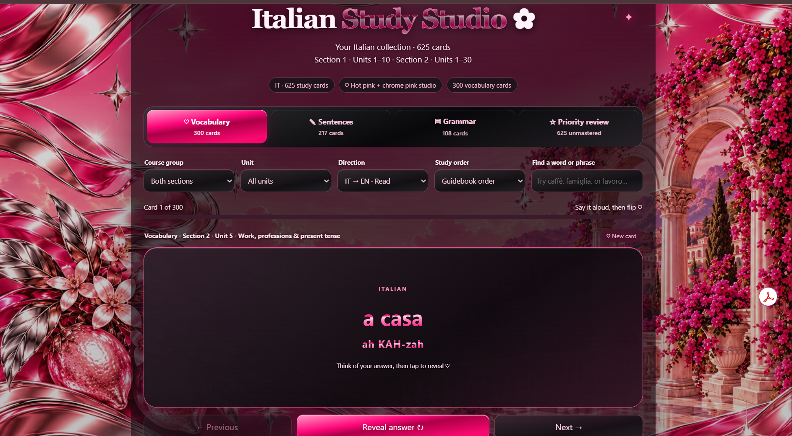
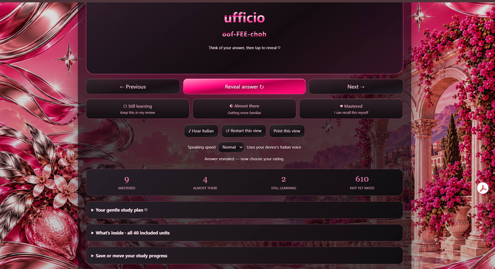

<h1 align="center">✦ Italian Study Studio ✦</h1>

  A personalized Italian language-learning web app built around interactive flashcards, pronunciation support, progress tracking, and a mobile-friendly study experience.

  

---

## ✦ Project Overview

Italian Study Studio is an interactive study app I created to make learning Italian more organized, visual, and personalized.

The project combines vocabulary, sentences, grammar, pronunciation practice, progress tracking, filtering, and self-rating tools in one place.

I built it around the way I actually study, with a strong focus on usability, mobile access, and making repeated review feel simple instead of overwhelming.

### Live Demo

**[Open Italian Study Studio](https://angela-italian-flashcards.coppergull1026.chatgpt.site/)**

---

## ✦ Screenshots

### Main Study View

### Progress & Review View

---

## ✦ Features

- 625 total Italian study cards
- 300 vocabulary cards
- 217 sentence cards
- 108 grammar cards
- Section and unit filtering
- Search by word or phrase
- Italian-to-English study mode
- Guidebook-order review
- Interactive flashcards
- Pronunciation support
- Browser-based Italian speech synthesis
- Adjustable speaking speed
- Self-rating system
- Still Learning, Almost There, and Mastered categories
- Progress tracking
- Priority review
- Study status counters
- Print view
- Restart study view
- Backup and restore tools
- Mobile-friendly layout
- Touch-friendly controls
- Separate Italian progress tracking
- Personalized hot pink and chrome visual design

---

## ✦ UX & Product Focus

This project was designed around real study behavior rather than simply displaying vocabulary.

I focused on questions like:

- How can users quickly find the words they need to review?
- How can study progress stay visible without becoming distracting?
- How can pronunciation support be easy to use repeatedly?
- How can the interface remain readable on both desktop and mobile?
- How can vocabulary, grammar, and sentence study be separated clearly?
- How can difficult words be prioritized for extra practice?
- How can users rate their confidence without interrupting the study flow?

The app has gone through multiple iterations based on how it actually felt to use during study sessions.

---

## ✦ What I Improved Through Iteration

As I continued using the app, I refined several parts of the experience:

- Improved mobile usability
- Increased text readability
- Refined flashcard navigation
- Simplified pronunciation controls
- Improved vocabulary organization
- Added confidence ratings
- Added progress tracking
- Added filtering and review options
- Separated vocabulary, grammar, and sentence content
- Improved visual hierarchy
- Reduced friction during repeated study sessions
- Added priority review
- Improved backup and restore functionality
- Improved the overall study workflow

---

## ✦ Technologies & Concepts

  

### Front End

- HTML
- CSS
- JavaScript

### Browser Features

- Speech Synthesis
- Local browser storage
- Interactive UI state
- Progress persistence

### Development Concepts

- Responsive design
- Mobile usability
- UI state management
- Data organization
- Iterative development
- User-centered design
- Product thinking
- Debugging
- Testing

---

## ✦ Skills Demonstrated

This project helped me practice skills beyond basic front-end development:

- User experience design
- Human-centered design
- Responsive web design
- Information architecture
- Product thinking
- Feature iteration
- Browser API integration
- Data organization
- State and progress management
- Mobile usability
- Accessibility awareness
- Visual hierarchy
- Debugging and testing
- User feedback analysis

---

## ✦ What I Learned

One of the biggest lessons from this project was that building a useful application involves more than making individual features work.

A feature can technically function and still create a frustrating experience.

While developing Italian Study Studio, I learned to pay more attention to:

- How users move through an interface
- Where unnecessary steps create friction
- How content should be organized
- How visual hierarchy affects usability
- How mobile users interact differently from desktop users
- How repeated use reveals design problems
- How progress information can motivate users
- How small interface changes can significantly improve the experience

This project helped me think more like both a developer and a product designer.

---

## ✦ Why I Built It

I am currently learning Italian and wanted a study tool that matched the way I actually learn.

Traditional flashcard tools did not give me the exact combination of vocabulary organization, pronunciation support, progress tracking, grammar review, filtering, visual customization, and confidence-based review that I wanted.

So I created my own.

What started as a simple flashcard idea gradually became a more complete study experience and one of my favorite examples of using technology to solve a real personal need.

---

## ✦ Study Experience

The app allows me to move between:

- Vocabulary
- Sentences
- Grammar
- Priority review

I can also filter by section and unit, search for specific words, change study direction, rate my confidence, listen to pronunciation, and track which cards I still need to master.

This makes the project feel more like a personalized study product than a simple static flashcard deck.

---

## ✦ Future Improvements

Ideas I would like to explore in future versions include:

- Spaced repetition scheduling
- More detailed study analytics
- Study streak tracking
- Session statistics
- More keyboard accessibility
- Additional review modes
- More personalization settings
- Expanded grammar tools
- Improved study recommendations
- More detailed pronunciation controls
- Progress charts and visual analytics

---

## ✦ Related Project

I am also developing a separate Portuguese Study Studio using a similar concept while keeping each language's content and study progress independent.

---

## ✦ Author

**Angela Ostorga Coreas**  
Software Engineering Student | UX • Product • Technology

[GitHub](https://github.com/angelacoreas1989-boop) •
[Portfolio](https://angelacoreas1989-boop.github.io/tech-portfolio/) •
[Italian Study Studio](https://angela-italian-flashcards.coppergull1026.chatgpt.site/)

---

  ✦ <strong>Building technology around real user needs.</strong> ✦

